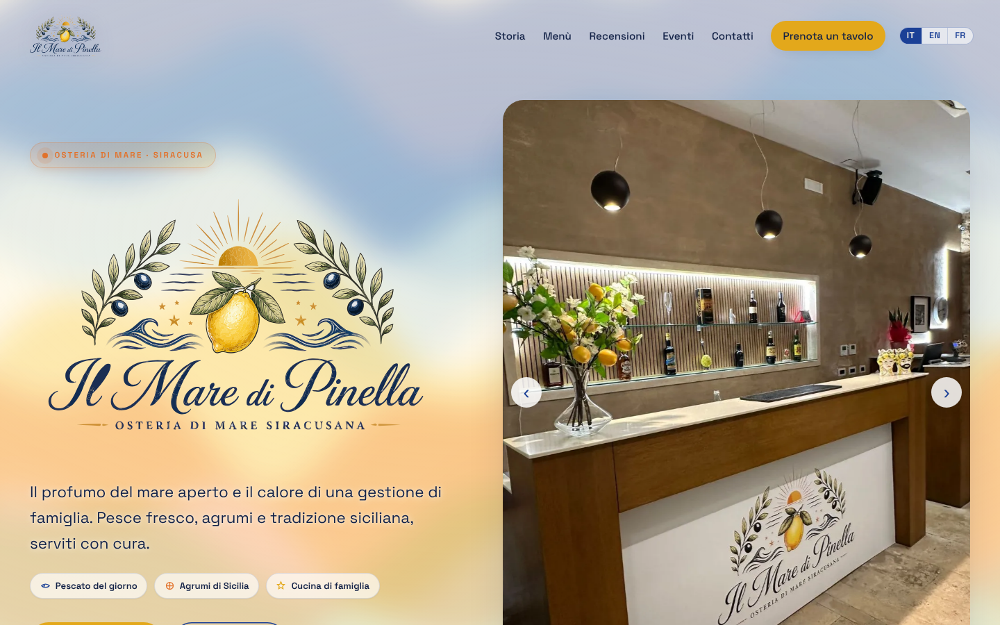
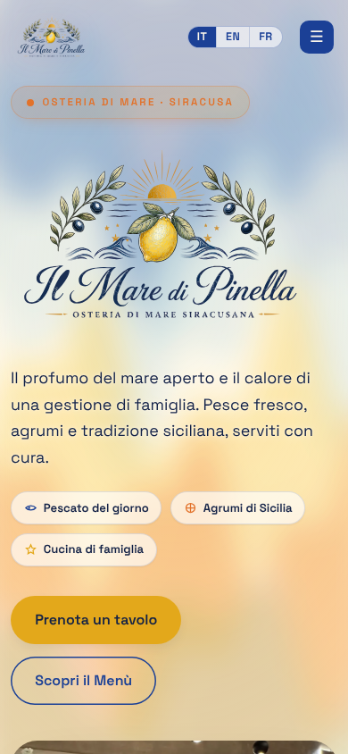

# Il Mare di Pinella — restaurant website

Website for **Il Mare di Pinella**, a family-run seafood osteria in Siracusa (Sicily).
Live at **[ilmaredipinella.it](https://ilmaredipinella.it)**.

## What it does

- **Three languages**: Italian, English and French, switchable on every page.
- **Interactive menu** with filters and allergen codes, generated from data instead of a PDF.
- **Owners' panel** (private page, email + password): the owners update menu, events with posters, and opening hours themselves; changes appear on the site immediately, with no redeploy.
- **Google reviews** loaded through a Netlify serverless function (Google Places API); the API key stays on the server.
- **Table booking** through Netlify Forms, with validation and a privacy checkbox.
- **GDPR-minded**: no third-party trackers or embeds, privacy and cookie policy pages.
- **SEO and sharing**: sitemap, robots.txt, structured opening hours, Open Graph preview.

## Stack

Static HTML, CSS and JavaScript (no build step) · GSAP for animations · Supabase (Postgres, Auth, Storage) with row-level security · Netlify hosting, Forms and Functions · GitHub Actions keep-alive for the Supabase free tier.

## Security notes

- The Supabase key in `assets/js/supabase-config.js` is the **publishable** key, which is meant to be public; writes are restricted by row-level security policies to an allowlist of owner accounts.
- Server-side secrets (Google Places key, WhatsApp token) live only in Netlify environment variables and have never been committed.

## How it was built

Built with AI coding assistants. My role: gathering requirements with the owners, directing design and content, setting up Supabase, Netlify and the domain, and testing on desktop and mobile.

## Run locally

Run `python -m http.server 8000` in the project folder, then open http://localhost:8000. Reviews and the owners' panel need the live Netlify and Supabase backends.

